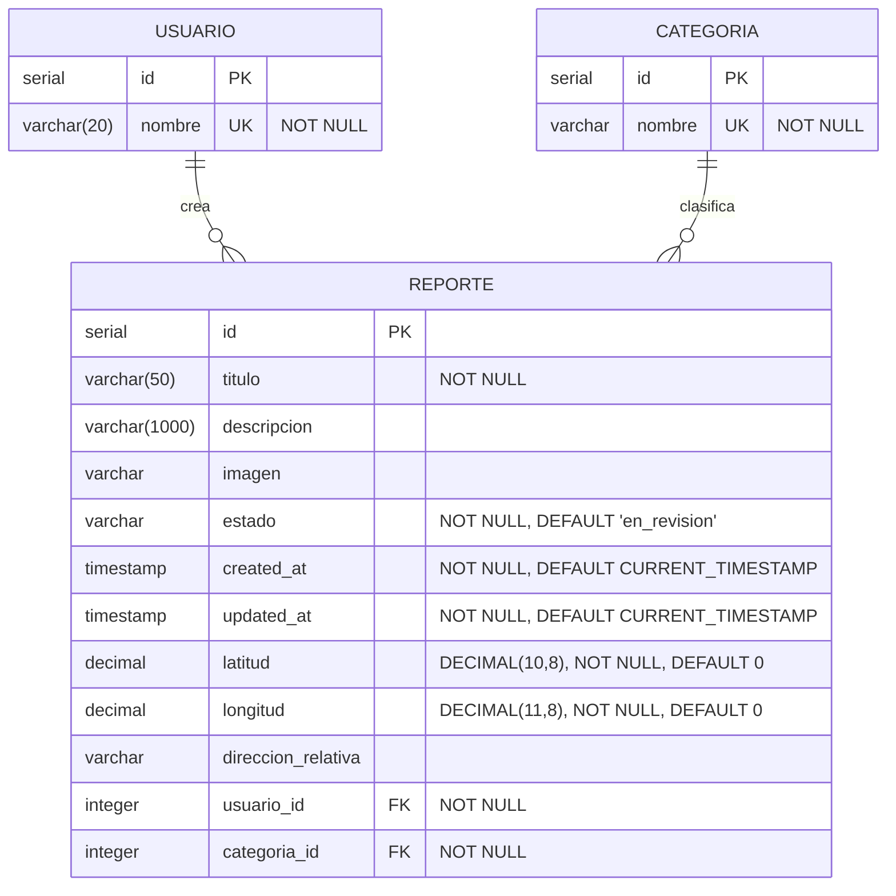

# Documentación

## Flujo de la aplicación

- **Pagina principal:** `GET /` muestra el formulario para crear reportes y la lista de reportes en la misma página.
- **Al crear un reporte:** el formulario hace `POST /reportes` mediante HTMX, sin recargar la página y luego vuelve a consultar la lista completa, HTMX la coloca en `#lista-reportes`. Por `hx-swap-oob`, el formulario se limpia para que el usuario cargue un nuevo reporte.
- **Al borrar un reporte:** El boton hace `DELETE /reportes/{id_reporte}`. El servidor elimina el reporte y responde `200 OK` con el cuerpo vacío; HTMX hace que la tarjeta del reporte desaparezca de la vista.
- **Detalle de un reporte:** `GET /reportes/{id_reporte}` muestra un reporte completo.
- **Errores:** Ante un error, ya sea por datos invalidos, reporte inexistente, ruta no definida o fallas internas. Se muestran en una pagina con el error y un boton para volver a la pagina principal.

## Capa de Datos

### Modelo principal

Esquema principal de la base de datos:

## Aclaraciones y limitaciones actuales

- **El usuario está fijo.** Los reportes se guardan con el usuario de id 1, el que crea `make inicializar-db`. Temporal hasta que se implemente lógica de registro de usuario.

## Trabajo futuro
- Crear pantallas para **crear y consultar** usuarios y categorías.

- El usuario debe **autenticarse con cookies o tokens** y los reportes se asociarán al usuario autenticado.

- Crear la ruta y vista para **Cambio de estado de un reporte**.

- Definir **roles** (usuario / administrador): el cambio de estado debería quedar restringido a administradores, y cada usuario solo debería poder modificar o eliminar sus propios reportes.

- Las columnas `latitud` y `longitud` de `reporte` tienen `DEFAULT 0` y el formulario todavía no las recibe, por lo que todos los reportes quedan en la coordenada (0, 0). Más adelante deberían tratarse correctamente, idealmente obteniéndolas desde un mapa interactivo.